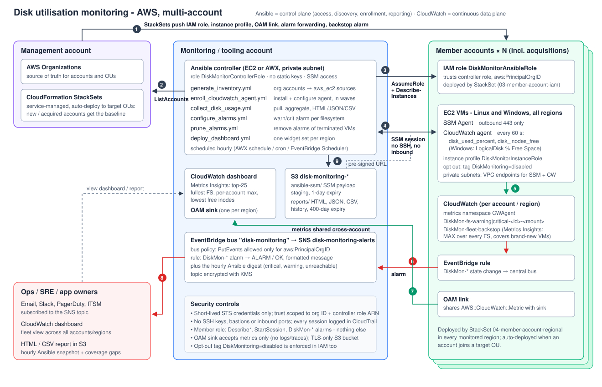

# Scalable disk monitoring for multi-account AWS (Ansible-first)

This solution monitors disk utilisation on every EC2 VM across all AWS accounts in an organisation, including accounts that came in through acquisitions. It warns early when disks are filling up, so they can be dealt with before they cause downtime.

**Cloud chosen: AWS.** The company already runs Ansible, so Ansible is the backbone. It handles access, discovery, enrollment, collection and reporting. Cloud-native services are added only where they clearly help:

| Need | Existing stack (Ansible) | Cloud-native add-on | Why the add-on is worth it |
|---|---|---|---|
| Reach VMs securely | `aws_ssm` connection plugin | **SSM Session Manager** | No SSH keys, bastions or inbound ports. IAM-authorised and logged in CloudTrail |
| Know which accounts and VMs exist | `aws_ec2` dynamic inventory, generated per account | **Organizations + StackSets** | A new or acquired account is covered automatically once it joins an OU |
| Disk data | `collect_disk_usage.yml`: hourly pull, report and SNS digest | **CloudWatch agent**, enrolled by Ansible | 60-second data. Alerting keeps working even if the controller is down |
| One pane of glass | HTML/CSV/JSON report in S3 | **CloudWatch cross-account dashboard** | Live view of every account and region with history. Cross-account sharing itself carries no extra charge |
| Alerts | SNS digest from the playbook | **CloudWatch alarms → EventBridge → SNS** | Minutes, not hours, from threshold breach to page |

Both paths are built and can run independently. **Ansible-only mode** costs close to nothing and needs no new tooling. **Hybrid mode** (recommended for production) adds continuous metrics where they matter. It can be turned on per environment or tier, e.g. `-e target=env_prod`.

---

## 1. Architecture



| # | Flow |
|---|---|
| 1 | **StackSets** (service-managed, auto-deploy) push the same baseline into every account in the target OUs: an IAM role the controller can assume, a VM instance profile, an OAM metrics link, an alarm-forwarding rule and a fleet backstop alarm. New or acquired accounts get it the moment they join the OU. |
| 2 | The **controller** lists active accounts from AWS Organizations and generates one `aws_ec2` inventory source and one assume-role profile per account. |
| 3 | For each account it **assumes `DiskMonitorAnsibleRole`** (short-lived STS credentials) and discovers running instances. |
| 4 | Ansible connects to VMs through **SSM Session Manager**. Module payloads are staged in S3 and fetched by the VM through a pre-signed URL. |
| 5 | The **CloudWatch agent** (installed and configured by Ansible) publishes `disk_used_percent` and `disk_inodes_free` every 60 s. |
| 6 | Per-filesystem **alarms** (created by Ansible) change state. A rule in each account forwards `DiskMon-*` events to a central **EventBridge bus**. |
| 7 | **OAM links** share metrics with the monitoring account, which hosts the cross-account **dashboard**. |
| 8 | The central bus fans alerts out through **SNS** (email, Slack, PagerDuty, ITSM). |
| 9 | The hourly Ansible run writes an **HTML/JSON/CSV report** and history to S3, and sends a digest that also lists **coverage gaps** (VMs that could not be reached). |

---

## 2. Key components

### 2.1 Access management: "how do we securely get into every VM in every account?"

* **One identity, no secrets.** The controller (an EC2 instance or AWX in the monitoring account) runs as `DiskMonitorControllerRole` from its instance profile. No access keys exist anywhere.
* **Hub-and-spoke role assumption.** Every member account has `DiskMonitorAnsibleRole` ([03-member-account-iam.yml](cloudformation/03-member-account-iam.yml)):
  * Its trust policy allows only the controller role's ARN, and only when `aws:PrincipalOrgID` matches our organisation.
  * On the controller side, `sts:AssumeRole` is limited to roles where `aws:ResourceOrgID` matches, so the controller cannot be pointed outside the organisation.
* **Least privilege.** The member role can do only these things: describe instances, start a Session Manager shell on instances not tagged `DiskMonitoring=disabled`, use the SSM staging prefix in S3, and manage alarms named `DiskMon-*`. It cannot change instances, read data or touch IAM.
* **SSM instead of SSH.** VMs need only outbound 443 (or VPC endpoints) to SSM. There are no keys, no bastions and no security-group holes, and access is revoked by revoking IAM. Every session appears in CloudTrail and can be logged to S3/CloudWatch through Session Manager preferences.
* **Profiles are generated, not hand-written.** [`generate_inventory.yml`](playbooks/generate_inventory.yml) writes one `[profile diskmon-<account-id>]` per account with `credential_source = Ec2InstanceMetadata` ([example](docs/examples/aws_config_profiles.ini)). Both the inventory plugin and the SSM connection plugin use these profiles, so credentials are always short-lived and scoped to one account.

### 2.2 VM discovery and enrollment for metric collection

| Step | How | File |
|---|---|---|
| Discover accounts | `organizations list-accounts`, keep only ACTIVE accounts, apply excludes and per-account region overrides, merge static accounts (acquisitions not yet in the org) | [roles/account_discovery](roles/account_discovery/tasks/main.yml), [config/accounts.yml](config/accounts.yml) |
| Discover VMs | One `amazon.aws.aws_ec2` source per account ([rendered example](docs/examples/222222222222.aws_ec2.yml)) with running-only filter, `instance-id` hostnames and an SSM connection set through `compose` | [aws_ec2.yml.j2](roles/account_discovery/templates/aws_ec2.yml.j2) |
| Group VMs | `account_<id>`, `region_<r>`, `env_<Environment tag>`, `tier_<DiskMonitoringTier tag>`, `linux`, `windows`, `no_instance_profile` | same |
| Opt-out | Everything is enrolled **by default**. Owners opt out with the tag `DiskMonitoring=disabled`, which is honoured in the inventory filter *and* in IAM | same + IAM policy |
| Enroll | [`enroll_cloudwatch_agent.yml`](playbooks/enroll_cloudwatch_agent.yml) installs the agent and pushes a disk-only config ([rendered](docs/examples/amazon-cloudwatch-agent.json)). It runs in waves (`serial: 20%`, `max_fail_percentage`) and handles Amazon Linux, RHEL-family, Debian/Ubuntu, SUSE and Windows | [roles/cloudwatch_agent](roles/cloudwatch_agent) |
| Alarms | [`configure_alarms.yml`](playbooks/configure_alarms.yml) creates a warning and a critical alarm **for every filesystem actually found** on each VM, so newly attached volumes get alarms on the next run | [roles/disk_alarms](roles/disk_alarms/tasks/main.yml) |
| Clean-up | [`prune_alarms.yml`](playbooks/prune_alarms.yml) deletes alarms of instances that no longer exist | |
| Safety net | `DiskMon-fleet-backstop`: one Metrics Insights alarm per account and region over *all* filesystems. It catches VMs launched between Ansible runs | [04-member-account-regional.yml](cloudformation/04-member-account-regional.yml) |

Stale inventory files for accounts that were closed or excluded are removed automatically.

### 2.3 Data collection

**Path A: Ansible-native (pull, hourly).** [`roles/disk_collector`](roles/disk_collector/tasks/main.yml)

* **Linux:** uses `ansible_mounts`, which gives bytes *and* inodes per mount. Fact gathering is bounded by `gather_timeout`, so a hung NFS mount cannot stall the run. Pseudo and ephemeral filesystems (tmpfs, overlay, squashfs, …) and container or kubelet paths are filtered out.
* **Windows:** reads `Win32_LogicalDisk` (fixed disks) through `win_powershell`.
* **Usage calculation:** used % counts root-reserved blocks as used. This matches what a non-root service can still write, which is what actually causes outages.
* **Status:** each filesystem is marked `ok`, `warning` or `critical` based on **space or inodes**. Inode exhaustion fills a disk even when space is left.
* **Unreachable VMs:** a VM that cannot be reached is *not* silently dropped. It is recorded as `unreachable` or `error` with the reason, and shows up as a coverage gap.

**Path B: CloudWatch agent (push, 60 s).** Ansible installs and configures it. The agent publishes `CWAgent/disk_used_percent` and `disk_inodes_free`, with dimensions `InstanceId`, `path` and `fstype`. On Windows it publishes `LogicalDisk % Free Space`.

### 2.4 Aggregation and presentation

* **Ansible report** ([roles/disk_report](roles/disk_report/tasks/main.yml)): runs on the controller and merges every host's result into:
  * `disk_report.html`: KPI tiles, a "needs attention" table, coverage gaps, a per-account roll-up and every filesystem. See the [rendered sample](docs/examples/sample_disk_report.html).
  * `disk_report.json` and `disk_report.csv`: for tooling or a spreadsheet. See the [JSON sample](docs/examples/sample_disk_report.json) and [CSV sample](docs/examples/sample_disk_report.csv).
  * `history.csv`: fleet counts per run, for trends.

  Reports are kept per run plus a `latest/` copy, and are published to `s3://disk-monitoring-…/reports/`. An SNS digest ([sample](docs/examples/sample_disk_alert.txt)) goes out when anything is warning, critical or unreachable.
* **CloudWatch dashboard** ([deploy_dashboard.yml](playbooks/deploy_dashboard.yml), [rendered body](docs/examples/dashboard.json)): built in the monitoring account from metrics shared by OAM links. For each region it shows:
  * the 25 fullest filesystems across all accounts
  * the fullest filesystem per account
  * the lowest free inodes

  Widgets are generated from the region list, so adding a region needs no hand-written JSON.

### 2.5 Scalability: what happens as accounts and VMs grow

| Growth | What happens | Manual work |
|---|---|---|
| New account (acquisition joins the org, or a new workload account) | The StackSet auto-deploys the role and baseline. The next `generate_inventory` run picks the account up from Organizations | **None** |
| Acquired account not yet in the org | Add it to `static_accounts`. Deploy template 03 there once (see the design doc) | One-off |
| New region | Add it to `default_regions`. Deploy the sink and StackSet instance for it. The dashboard rebuilds itself | Config change |
| New VMs | They appear in inventory on the next run and are enrolled and alarmed. The backstop alarm covers the gap until then | **None** |
| New volume on an existing VM | The collector finds it and `configure_alarms` adds alarms | **None** |
| Terminated VMs | `prune_alarms` deletes their alarms | **None** |
| Thousands of VMs | See below | |

How it holds up with thousands of VMs:

* **Data path decoupled from Ansible:** CloudWatch is a push model. Ansible only enrolls VMs and re-asserts their configuration, so monitoring freshness does not depend on how long a playbook takes.
* **Controller scales wide:** SSM sessions are cheap for the controller (`forks = 50`, raise as needed), and there are no bastions to saturate.
* **Inventory caching:** results are cached for 10 minutes so repeated runs don't hammer EC2 APIs.
* **Spread-out API quotas:** every account has its own API quotas, so per-account credentials spread the load.
* **Larger fleets:** run the job in AWX with **job slicing**, or one job per account group (`-e target=account_222222222222`), to fan out across execution nodes.
* **Flat-cost catch-all:** the fleet backstop alarm costs the same however many VMs there are.

### 2.6 Security summary

* No long-lived credentials. Every grant is scoped to the organisation ID.
* No SSH and no inbound ports. Every session is in CloudTrail.
* The OAM sink accepts **metrics only**, so no logs or traces leave member accounts.
* The S3 bucket is TLS-only, blocks public access and expires SSM staging objects after 1 day. The SNS topic is KMS-encrypted.
* The opt-out tag is enforced in IAM, not just in the inventory.

---

## 3. Repository layout

```
ansible.cfg                       forks, inventory cache, fact cache
config/accounts.yml               discovery mode, regions, excludes, overrides
inventories/aws/                  generated per-account aws_ec2 sources (git-ignored)
inventories/local/hosts.yml       local demo inventory (2 reachable + 1 unreachable host)
playbooks/
  generate_inventory.yml          Organizations → inventory sources + assume-role profiles
  enroll_cloudwatch_agent.yml     install/configure agent in waves
  collect_disk_usage.yml          Ansible-native collection → report → S3 → SNS
  configure_alarms.yml            per-filesystem warning/critical alarms
  prune_alarms.yml                delete alarms of terminated instances
  deploy_dashboard.yml            central cross-account dashboard
  site.yml                        the scheduled job (enroll + collect + alarms + prune)
  group_vars/all.yml              thresholds, names, toggles
roles/
  account_discovery/              account + VM discovery
  cloudwatch_agent/               enrollment (Linux + Windows)
  disk_collector/                 per-host collection, status evaluation
  disk_report/                    aggregation, HTML/JSON/CSV, S3, SNS
  disk_alarms/                    CloudWatch alarms per filesystem
cloudformation/
  01-monitoring-account.yml       controller role, bucket, event bus, SNS
  02-monitoring-sink.yml          OAM sink (per region)
  03-member-account-iam.yml       StackSet: Ansible role, instance profile, event role
  04-member-account-regional.yml  StackSet: OAM link, alarm forwarding, backstop alarm
scripts/deploy.sh                 deploys 01-04 (StackSets with auto-deployment)
docs/architecture.svg             diagram above
docs/DESIGN.md                    decisions, trade-offs, failure modes, cost
docs/examples/                    rendered outputs (inventory, profiles, agent config, dashboard, sample report)
.github/workflows/ci.yml          lint + end-to-end demo run on every push
```

---

## 4. Getting started

**Prerequisites:**

* AWS Organizations with trusted access for CloudFormation StackSets.
* A monitoring (tooling) account.
* The monitoring account registered as delegated administrator for Organizations, or an `org_reader_profile` that can call `ListAccounts`.

```bash
# 1. Foundations (idempotent)
MGMT_PROFILE=mgmt MON_PROFILE=monitoring ORG_ID=o-abc123xyz \
TARGET_OUS="ou-ab12-workloads ou-ab12-acquired" ALERT_EMAIL=sre@example.com \
REGIONS="us-east-1 us-west-2 eu-west-1" ./scripts/deploy.sh

# 2. Launch the controller (EC2 in a private subnet, instance profile DiskMonitorControllerRole)
#    and connect to it with: aws ssm start-session --target <controller-id>

# 3. On the controller
git clone <this repo> && cd aws-disk-monitoring
make deps                       # ansible-core, boto3, collections
vi playbooks/group_vars/all.yml # monitoring_account_id, thresholds, alert toggles
make inventory                  # Organizations → inventories/aws/*.aws_ec2.yml
make graph                      # see accounts, regions, envs, linux/windows
make site                       # enroll + collect/report + alarms + prune
make dashboard
```

Schedule `make site` hourly, e.g. as an AWX schedule, a systemd timer, or cron on the controller. Run `make inventory` first in the same job; `make site` already depends on it.

### Try it locally (no AWS needed)

The local demo exercises the full collection → aggregation → report path, including how an unreachable VM is reported:

```bash
make deps
make demo     # = ansible-playbook -i inventories/local playbooks/collect_disk_usage.yml
```

Open `reports/latest/disk_report.html`. The same demo runs in [GitHub Actions](.github/workflows/ci.yml) on every push: it asserts the expected counts and uploads the report as a build artifact.

---

## 5. Operating it

* **Thresholds:** `disk_warning_pct` / `disk_critical_pct` and the inode equivalents in `group_vars/all.yml`. Per-group overrides go in `playbooks/group_vars/env_prod.yml`, `playbooks/group_vars/tier_critical.yml`, and so on.
* **Exclude a VM:** tag it `DiskMonitoring=disabled`.
* **Exclude an account:** add it to `excluded_account_ids`.
* **Run against one account or environment:** `-e target=account_222222222222` or `-e target=env_prod`.
* **CI gating:** `-e report_fail_on_critical=true` makes the run exit non-zero when anything is critical.
* **Coverage gaps:**
  * VMs in group `no_instance_profile` need `DiskMonitorInstanceRole` attached, or Default Host Management Configuration enabled for SSM.
  * `unreachable` usually means the SSM agent is not running or there is no network path to SSM.

## 6. Cost (approximate, us-east-1 list prices; check current pricing)

| Mode | 1,000 VMs, about 2 filesystems each |
|---|---|
| Ansible-only | Controller instance (about a t3.medium) plus a few S3 and SNS requests: **tens of dollars a month** |
| Hybrid | About 4,000 custom metrics (2 metrics × 2,000 filesystems) at $0.30 ≈ $1,200, plus about 4,000 alarms at $0.10 ≈ $400. Total **≈ $1.6k a month** |

Ways to trim hybrid mode:

* Collect only `used_percent`, which halves the metrics.
* Create only critical alarms.
* Enroll only `env_prod` or `tier_critical` in CloudWatch and leave the rest on hourly Ansible collection. This trade-off is the main reason the solution keeps both paths.

## 7. Next steps

* **Forecasting:** use `history.csv` and CloudWatch anomaly detection to estimate "days until full" and alert on the trend, not just the level.
* **Auto-remediation:** an EventBridge rule on `DiskMon-*` ALARM triggers an AWX job template. That job rotates and vacuums logs, cleans package caches, or grows the EBS volume (`ec2_vol` modify + `growpart` + `xfs_growfs`/`resize2fs`).
* **Same pattern on Azure and GCP:**

  | Here (AWS) | Azure | GCP |
  |---|---|---|
  | Organizations | Management Groups | Folders / Org |
  | StackSets | Azure Policy | Org Policy / Terraform |
  | Assume-role | Managed identity + Lighthouse | Service-account impersonation |
  | SSM | Arc / Run Command | IAP / OS Config |
  | CloudWatch agent | Azure Monitor Agent | Ops Agent |
  | `aws_ec2` inventory | `azure_rm` | `gcp_compute` |
